<!--
  Every image is a <picture>: GitHub loads assets/dark/<name>.svg when the visitor
  uses a dark theme, and the light assets/<name>.svg otherwise (also the fallback).
  assets/dark/ is generated: run `python3 scripts/build-themes.py` after editing a light SVG.
-->

<!-- Hero Banner & About Me / Currently Bento -->

  <picture>
    <source media="(prefers-color-scheme: dark)" srcset="./assets/dark/Hero-Banner.svg" />
    
  </picture>
  <picture>
    <source media="(prefers-color-scheme: dark)" srcset="./assets/dark/bento-about-currently.svg" />
    
  </picture>

<!-- Featured Projects Header (upcoming)

  <picture>
    <source media="(prefers-color-scheme: dark)" srcset="./assets/dark/header-projects.svg" />
    
  </picture>

-->

<!-- Clickable Project Cards Side-by-Side (upcoming)

  <a href="https://github.com/MrPanda009/SETU-DRR">
    <picture>
      <source media="(prefers-color-scheme: dark)" srcset="./assets/dark/card-setu-drr.svg" />
      
    </picture>
  </a>
  <a href="https://github.com/MrPanda009/Nyay-AI-Liard">
    <picture>
      <source media="(prefers-color-scheme: dark)" srcset="./assets/dark/card-nyay-ai.svg" />
      
    </picture>
  </a>
  <a href="https://github.com/MrPanda009/AWS-Auditor">
    <picture>
      <source media="(prefers-color-scheme: dark)" srcset="./assets/dark/card-aws-auditor.svg" />
      
    </picture>
  </a>

-->

<!-- Tech Stack, Live GitHub Stats & Socials (upcoming)

  <picture>
    <source media="(prefers-color-scheme: dark)" srcset="./assets/dark/bento-bottom.svg" />
    
  </picture>

-->
