<!--
  The whole page is generated: one continuous sheet of images, each a <picture> that loads
  assets/composed/dark/<name>.svg in dark mode and assets/composed/<name>.svg otherwise.
  - Edit the parts in assets/ (light sources), then run `python3 scripts/build-themes.py`.
  - FEATURED_PROJECTS comes from projects.md: edit it, then run `python3 scripts/build-projects.py`.
  - LET'S_CONNECT button links live in BUTTONS in scripts/sheet.py.
  - The GITHUB_STATS numbers and grid are refreshed daily by .github/workflows/update-stats.yml.
-->

<!-- page:start -->
<!-- GENERATED by scripts/sheet.py (via build-themes.py): the whole page as one continuous sheet.
     Edit the parts in assets/, projects.md, or BUTTONS in scripts/sheet.py, then run build-themes.py. -->

<picture><source media="(prefers-color-scheme: dark)" srcset="./assets/composed/dark/profile.svg" /></picture><a href="https://github.com/MrPanda009"><picture><source media="(prefers-color-scheme: dark)" srcset="./assets/composed/dark/sheet-btn-github.svg" /></picture></a><a href="https://www.linkedin.com/in/shrey-singh-70898237b/"><picture><source media="(prefers-color-scheme: dark)" srcset="./assets/composed/dark/sheet-btn-linkedin.svg" /></picture></a><a href="https://x.com/MrPanda009w"><picture><source media="(prefers-color-scheme: dark)" srcset="./assets/composed/dark/sheet-btn-x.svg" /></picture></a><a href="mailto:shrey33005@gmail.com"><picture><source media="(prefers-color-scheme: dark)" srcset="./assets/composed/dark/sheet-btn-email.svg" /></picture></a><picture><source media="(prefers-color-scheme: dark)" srcset="./assets/composed/dark/sheet-btn-portfolio.svg" /></picture><a href="https://github.com/MrPanda009?tab=repositories"><picture><source media="(prefers-color-scheme: dark)" srcset="./assets/composed/dark/sheet-projects-header.svg" /></picture></a><a href="https://github.com/MrPanda009/NyayAI"><picture><source media="(prefers-color-scheme: dark)" srcset="./assets/composed/dark/sheet-project-nyayai.svg" /></picture></a><a href="https://github.com/MrPanda009/ps-crmdev1"><picture><source media="(prefers-color-scheme: dark)" srcset="./assets/composed/dark/sheet-project-jansamadhan.svg" /></picture></a><a href="https://github.com/MrPanda009/environmental-hacks"><picture><source media="(prefers-color-scheme: dark)" srcset="./assets/composed/dark/sheet-project-aws-auditor.svg" /></picture></a><picture><source media="(prefers-color-scheme: dark)" srcset="./assets/composed/dark/sheet-project-setu-drr.svg" /></picture><picture><source media="(prefers-color-scheme: dark)" srcset="./assets/composed/dark/sheet-footer.svg" /></picture>

<!-- page:end -->
