<!--
  Every image is a <picture>: GitHub loads assets/dark/<name>.svg when the visitor
  uses a dark theme, and the light assets/<name>.svg otherwise (also the fallback).
  assets/dark/ and assets/composed/ are generated: run `python3 scripts/build-themes.py` after editing a light SVG.
  The GITHUB_STATS numbers and grid are refreshed daily by .github/workflows/update-stats.yml.
  FEATURED_PROJECTS comes from projects.md: edit that file, then run `python3 scripts/build-projects.py`.
-->

<!-- Hero Banner, About Me / Currently Bento and Tech Stack / GitHub Stats Bento, stacked into ONE image by
     scripts/compose.py (separate stacked images leave a faint seam line on 1x screens). Edit the parts in assets/. -->

  <picture>
    <source media="(prefers-color-scheme: dark)" srcset="./assets/composed/dark/profile.svg" />
    
  </picture>

<!-- LET'S_CONNECT: one linked pixel button per link (links inside a single README image can't be clicked).
     Portfolio has no link yet: its button is dashed and muted. -->

  <a href="https://github.com/MrPanda009"><picture><source media="(prefers-color-scheme: dark)" srcset="./assets/dark/btn-github.svg" /></picture></a>
  <a href="https://www.linkedin.com/in/shrey-singh-70898237b/"><picture><source media="(prefers-color-scheme: dark)" srcset="./assets/dark/btn-linkedin.svg" /></picture></a>
  <a href="https://x.com/MrPanda009w"><picture><source media="(prefers-color-scheme: dark)" srcset="./assets/dark/btn-x.svg" /></picture></a>
  <a href="mailto:shrey33005@gmail.com"><picture><source media="(prefers-color-scheme: dark)" srcset="./assets/dark/btn-email.svg" /></picture></a>
  <picture><source media="(prefers-color-scheme: dark)" srcset="./assets/dark/btn-portfolio.svg" /></picture>

<!-- FEATURED_PROJECTS: generated from projects.md by scripts/build-projects.py -->
<!-- projects:start -->
<!-- GENERATED by scripts/build-projects.py from projects.md. Edit projects.md, not this block. -->

  <a href="https://github.com/MrPanda009?tab=repositories"><picture><source media="(prefers-color-scheme: dark)" srcset="./assets/dark/projects-header.svg" /></picture></a>

  <a href="https://github.com/MrPanda009/NyayAI"><picture><source media="(prefers-color-scheme: dark)" srcset="./assets/dark/project-nyayai.svg" /></picture></a><a href="https://github.com/MrPanda009/ps-crmdev1"><picture><source media="(prefers-color-scheme: dark)" srcset="./assets/dark/project-jansamadhan.svg" /></picture></a><a href="https://github.com/MrPanda009/environmental-hacks"><picture><source media="(prefers-color-scheme: dark)" srcset="./assets/dark/project-aws-auditor.svg" /></picture></a> 
  <picture><source media="(prefers-color-scheme: dark)" srcset="./assets/dark/project-setu-drr.svg" /></picture>

<!-- projects:end -->
